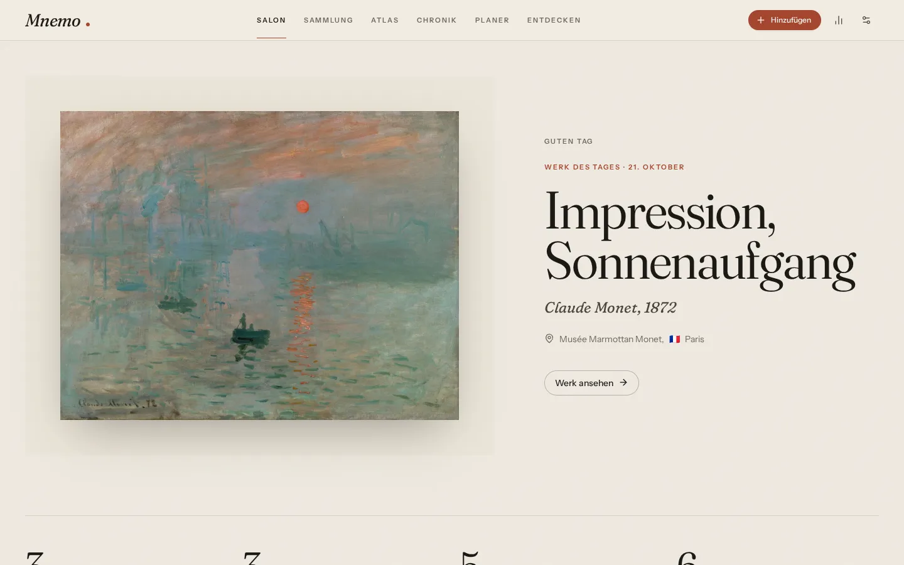
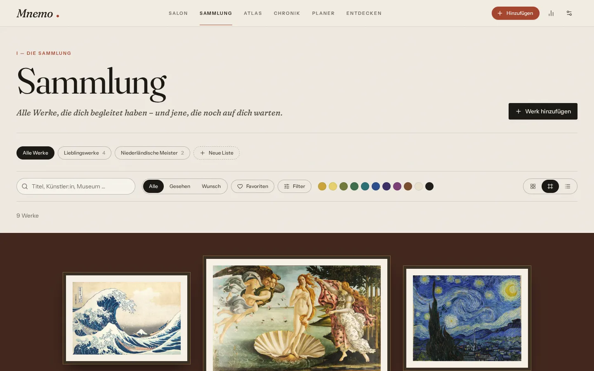
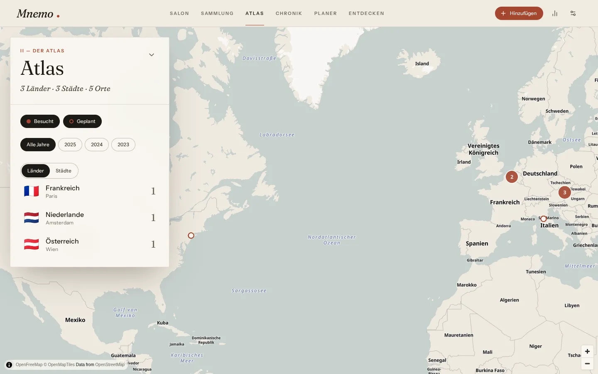
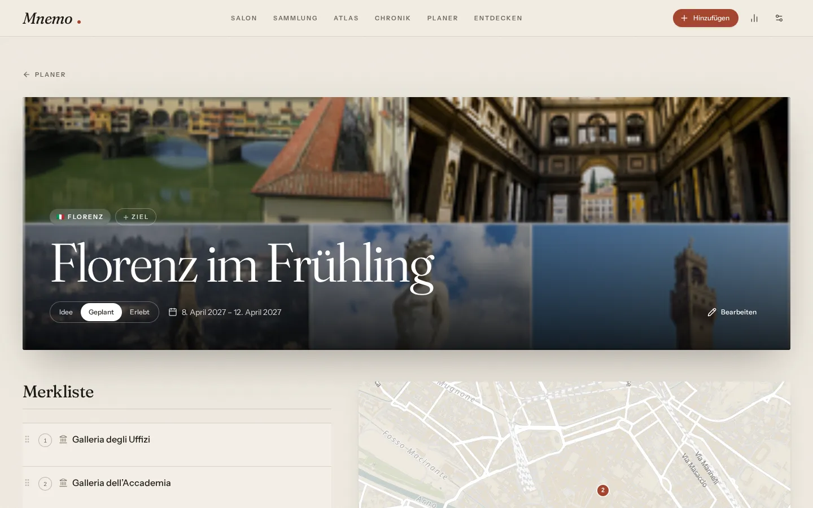
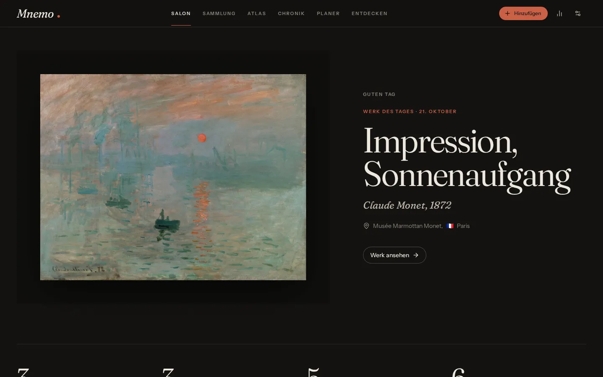
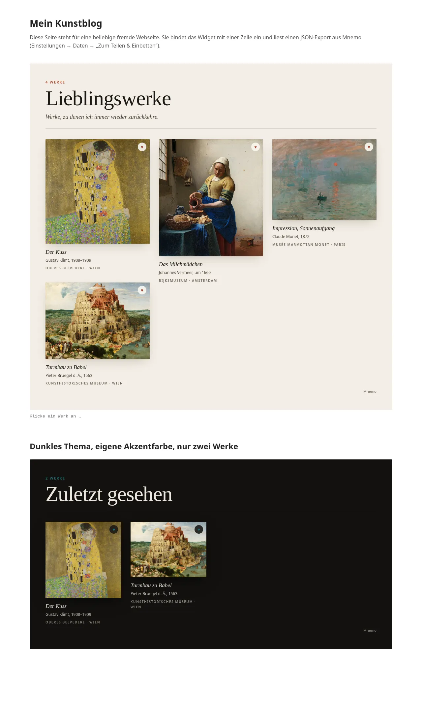

# Mnemo

**A personal archive of your encounters with art.** Mnemo remembers which works moved you,
where you came across them and where your next trip should take you. The name comes from
Mnemosyne, the goddess of memory and mother of the Muses, after whom the museum is named.



| Salon hang | Atlas |
| --- | --- |
|  |  |
| **Trip planner** | **Dark mode with the “Nocturne” background** |
|  |  |

## Features

| Area | What it does |
| --- | --- |
| **Salon** | Artwork of the day from your own collection, key figures, recently added, next trip, a greeting that depends on the time of day |
| **Collection** | Masonry gallery, **salon hang** (framed works on a coloured wall) and list view. Filter by status, favourites, period, artist, city, tag and **colour**. Custom lists, images via drag & drop |
| **Artwork** | Large view with **deep zoom** (OpenSeadragon, IIIF), automatically extracted **colour palette**, the page accent colour adapts to the work, source and licence, related works |
| **Photos** | Images are downscaled and stored locally. **EXIF** provides date and GPS; if a museum is nearby, the app suggests it (“Were you at the Albertina?”) |
| **Atlas** | Custom paper-toned map style (MapLibre and OpenFreeMap, no API key), visited and planned places, clusters, year filter, country list with flags |
| **Journal** | Travel journal of all museum visits by year, with photos, impressions and companions |
| **Planner** | Board with Idea, Planned and Done (drag & drop). Per trip: suggestions from **OpenStreetMap** with Wikipedia texts and images, a sortable watchlist, a map. Checked-off places can become a visit in the journal |
| **Discover** | Combined search across Wikidata/Commons, Art Institute of Chicago, The Met and Cleveland Museum of Art (optionally Europeana and Harvard with a key). Add results as “seen” or “want to see” |
| **Insights** | Countries, cities, visits, colour spectrum of all works seen, visits per year, periods, most-seen artists |
| **Personalisation** | Light, dark or system; accent colours based on painting pigments or taken automatically from the artwork of the day; backgrounds: paper, five gradients, one of your works, your own image or the artwork of the day (blurred) |
| **Data** | Everything stays local in the browser (IndexedDB), works offline (PWA), ZIP backup, JSON export for sharing, import |
| **Languages** | German and English, with type-checked translation keys |

## Quick start

Requirements: Node.js ≥ 24 and pnpm.

```bash
pnpm install
pnpm dev          # app at http://localhost:5173
pnpm dev:embed    # widget demo at http://localhost:5174
```

On first launch the Salon offers **“Start with examples”**. This creates nine public-domain
works, five museums and two trip ideas. You can delete them again at any time under
Settings → Data.

| Command | Purpose |
| --- | --- |
| `pnpm build` | Build the widget and the app (`apps/web/dist`, incl. service worker and icons) |
| `pnpm preview` | Serve the production build locally |
| `pnpm check` | Lint + typecheck + unit tests |
| `pnpm test` | Vitest (core, storage, providers, embed, web) |
| `pnpm e2e` | Playwright tests on desktop and mobile, without network access (run `pnpm exec playwright install chromium` once) |
| `pnpm format` | Biome formatting |

## Architecture

```
apps/
  web/            PWA: React 19, TanStack Router + Query, Tailwind v4
    src/modules/  one folder per area (home, art, travel): nav, quick add, dialogs, routes
    src/features/ the pages and forms the modules wire up
  embed-demo/     third-party sample page that embeds the widget
packages/
  core/           data model (zod), repository contracts, domain logic – no React, no DB
  storage-dexie/  IndexedDB implementation of the store
  providers/      adapters for museum APIs, geocoding, POIs, Wikipedia
  ui/             design system: tokens, Tailwind theme, components
  i18n/           de/en dictionaries + i18next setup
  embed/          <mnemo-gallery> web component (12 kB, no framework)
```

Dependencies only point inwards: `web → ui, providers, storage-dexie, i18n → core`.
`core` knows neither React nor IndexedDB.

**Data flow:** Features read through hooks in `apps/web/src/app/data.ts`, i.e. through
TanStack Query with keys `['local', table, …]`. Writes go straight to the store
(`useStore()`). The store reports every change, including those from other tabs, and
`MnemoProvider` then invalidates the affected queries. That is why there is no manual refresh
and no global state container.

**One registry for all data.** `packages/core/src/model/registry.ts` lists every persisted
entity type. The store contract (`MnemoStore`), snapshots, the archive format, backups and the
IndexedDB store are derived from it, so a new type is one schema plus one registry entry.

**Migrations.** `SCHEMA_VERSION` counts changes to persisted data. Each bump adds a pure,
per-row step to `packages/core/src/migrations.ts`; the same steps run when IndexedDB upgrades
(Dexie versions follow the schema version, see `packages/storage-dexie/src/db.ts`) and when an
older backup is imported. Rows carry their own `schemaVersion`, so mixed data migrates safely.

**Collectibles and lists.** Types that can be collected (today artworks) share
`collectibleShape` (title, favourite, tags, notes, images, palette). Lists hold typed
references `{ kind, id }`, so one list can mix artworks with future types such as books.

**Domain rules** live in `packages/core/src/services`, for example “deleting a place also
deletes its visits and unlinks its works” or “a completed trip item becomes a visit”. This
way they apply equally to every storage backend.

## Extending and integrating

### 1. Plug in a different backend

Implement the `MnemoStore` interface from `@mnemo/core` (e.g. via REST or Supabase) and pass
it to the app:

```tsx
import { AppProviders } from './app/providers';

<AppProviders store={createRestStore('https://api.example.com')}>
  <RouterProvider router={router} />
</AppProviders>
```

The only requirement is that `subscribe()` reports changes, for example via WebSocket or
after your own writes. All features stay unchanged. `snapshot()` and `restore()` are the
foundation for a future sync.

### 2. Reuse parts in another React app

- `@mnemo/ui`: components and tokens. Add `@import '@mnemo/ui/theme.css'` and
  `@source '<path>/packages/ui/src'` to your own CSS. Colours, fonts and radii are
  `--mn-*` variables and can be overridden on any parent element.
- `@mnemo/providers`: museum and place search without React, usable on the server too.
- `@mnemo/core`: data model, validation, statistics and filters.
- Feature pages from `apps/web/src/features/*` run in any app that uses `AppProviders`.

### 3. Embed the widget on any website

1. In Mnemo, export a list as JSON under Settings → Data → *For sharing & embedding*.
2. `pnpm --filter @mnemo/embed build` produces `packages/embed/dist/mnemo-embed.js`.
3. Put both on your website and include them:

```html
<script type="module" src="mnemo-embed.js"></script>
<mnemo-gallery src="mnemo-favourites.json" collection="Favourites" theme="auto" columns="3"></mnemo-gallery>
```

| Attribute | Meaning |
| --- | --- |
| `src` | URL of the JSON export (alternatively via JS: `el.data = archive`) |
| `collection` | Name or ID of a list |
| `filter` | `all`, `favorites`, `seen`, `wishlist` |
| `limit`, `columns`, `heading` | Number of items, columns, custom heading |
| `theme` | `light`, `dark`, `auto` |
| `lang` | `de` or `en` |

The widget dispatches `mnemo-select` with the selected work as `detail`. It can be styled
from the outside via `--mnemo-accent`, `--mnemo-bg`, `--mnemo-font-display` etc., as well as
via `::part(item)`, `::part(caption)` and `::part(header)`.



### 4. Add a new area or collectible type

A new collection type such as books touches these places, in this order:

1. **Model** – schemas in `packages/core/src/model/entities.ts` (spread `collectibleShape`), add
   the kind to `collectibleKinds`, register the table in `registry.ts` and `collectibleTables`.
   The compiler then points at every place that must handle the new kind (e.g. `subsetArchive`).
2. **Migration** – bump `SCHEMA_VERSION`, append a step to `migrations.ts` (`tables: {}` if no
   existing rows change) and add the new table's indexes under that version in `STORES`
   (`packages/storage-dexie/src/db.ts`). Tests check that versions and tables line up.
3. **Data sources** – a provider interface and adapters in `packages/providers/src/<area>/`.
   Providers that need a key declare `requiresKey` and appear in the settings automatically.
4. **UI** – pages and forms in `apps/web/src/features/<area>/`, then a module in
   `apps/web/src/modules/<area>/` with `index.ts` (nav, quick add, dialogs; dialog parameters
   via `declare module '../../app/dialogs'`) and `routes.tsx`. Register it in
   `src/modules/index.ts` and its routes in `src/app/router.tsx`.
5. **Texts & release notes** – keys in `packages/i18n`, an entry in `apps/web/src/changelog.ts`
   (shown as “What's new”) and in `CHANGELOG.md`; bump the version in `apps/web/package.json`.

### 5. Add a new art data source

Implement `ArtworkSearchProvider` in `packages/providers/src/art/` and register it in
`artProviders` (`packages/providers/src/index.ts`). “Discover” then shows it automatically.
Please test mapper functions against a real, trimmed API response in `test/fixtures/`.

## External services: notes from practice

All services are free and require no account. The code handles a few quirks:

- **The Met:** The old search API `v1/search` was shut down on October 1, 2026. Mnemo uses
  `v1.1/search`.
- **Wikimedia (Wikidata, Commons, Wikipedia):** Requests carry an `Api-User-Agent`.
  `Special:FilePath` links send no CORS headers, so Mnemo resolves them through the Commons
  API before downloading, allowing images to be stored and analysed locally. Under heavy load
  the Wikidata Query Service throttles temporarily (HTTP 429). Title and artist searches
  therefore run separately and may fail individually.
- **Overpass (trip suggestions):** The public servers are often busy; responses can take
  30–60 s. Mnemo queries two instances in parallel, takes the first response and caches
  results for a day.
- **Cleveland Museum of Art:** The CDN sometimes serves cached responses without CORS
  headers. An extra parameter keeps browser requests in their own cache entries.
- **Art Institute of Chicago:** The image servers sit behind Cloudflare and block automated
  browsers. In regular browsers they usually work. If not, Mnemo shows a typographic
  placeholder and stores only the link.
- **Europeana / Harvard:** Get a free key and enter it in the settings.

## Privacy

All entries and images stay in your browser's IndexedDB. Mnemo asks the browser for
persistent storage (`navigator.storage.persist()`). External services only receive what you
search for: search terms, place coordinates for suggestions and image requests. Since there
is no server, there is no sync either, so back up your data regularly as a ZIP.

## Roadmap

The foundation (registry, migrations, typed lists, app modules) is in place for these steps:

1. **People:** a `creators` entity (artists, later authors) linked to Wikidata, replacing the
   free-text artist field via a migration.
2. **Library:** a `book` collectible with Open Library and Google Books as sources, ISBN scan
   via the camera, reading status, quotes and lending.
3. **More data:** further museum APIs (Rijksmuseum, V&A, Smithsonian), a `⌘K` search across all
   collectibles, `.ics` export of trips.
4. **Hosting & sync:** static hosting first; then a `sync` package (e.g. Supabase) on top of the
   local store, with `deletedAt` tombstones so deletions reach other devices.
5. **Assistance:** optional AI features (descriptions, tags, museum label OCR) behind a server
   proxy, so no API key lives in the browser.

Smaller ideas: exhibition mode (full-screen slideshow), an art passport of visited museums, a
postcard of a work as PNG, and two works side by side with synchronised deep zoom.
